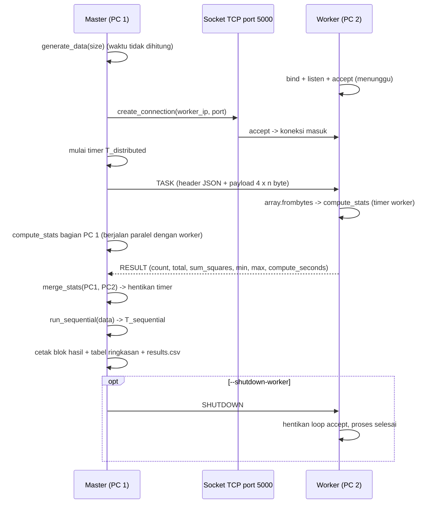

# DOKUMENTASI — Distributed Number Statistics (Distributed Memory 2 PC)

NPM: 247006111152
Nama: Zheka Baila Arkan
Stack: Python 3.10+ (standard library saja), komunikasi TCP lewat modul `socket`.

---

## 1. Ringkasan Aplikasi

Aplikasi ini membagi sekumpulan angka acak ke **dua PC** yang terhubung lewat jaringan LAN.
Setiap PC punya memorinya sendiri (distributes memory), menghitung statistik parsial atas
bagian yang ia terima, lalu hasilnya digabung menjadi statistik akhir.

Statistik yang dihitung: jumlah elemen (`count`), total (`sum`), jumlah kuadrat
(`sum_squares`), nilai terkecil (`min`), nilai terbesar (`max`), rata-rata (`mean`), dan
standar deviasi populasi (`std_dev`).

Alasan tema ini dipilih: statistik dasar bersifat **asosiatif dan komutatif**, sehingga hasil
parsial dari tiap PC bisa digabung tanpa perlu mengirim ulang data mentahnya. Pembagian kerja
menjadi dua bagian juga trivial, dan tidak butuh library eksternal.

### Peran PC

| PC | Peran | Tugas |
|----|-------|-------|
| PC 1 | Master / Coordinator | Membangkitkan data, membagi dua, mengirim bagian kedua ke PC 2 lewat socket, menghitung bagian pertama, menerima hasil PC 2, menggabungkan, mencetak laporan dan `results.csv` |
| PC 2 | Worker / Processor | Mendengarkan port TCP, menerima data, menghitung statistik bagiannya, mengirim hasil kembali, bisa dipakai berulang tanpa restart |

### Cara kerja dalam satu kalimat

Master mengirim separuh data sebagai byte mentah ke worker; kedua PC menghitung bagiannya
masing-masing; worker mengirim ringkasan kecil (bukan data mentah) kembali ke master; master
menggabungkan dua ringkasan menjadi hasil akhir dan membandingkan waktunya dengan mode
sequential satu PC.

---

## 2. Struktur Folder

```
distributed-number-statistics/
├── AGENTS.md                       # spesifikasi dan aturan kerja untuk AI agent
├── PLAN.md                         # urutan fase pengerjaan
├── README.md                       # panduan singkat instalasi sampai program jalan
├── requirements-dev.txt            # dependensi dev, hanya pytest
├── src/
│   ├── __init__.py                 # penanda paket src
│   ├── config.py                   # semua konstanta: identitas, port, ukuran data, seed, timeout
│   ├── protocol.py                 # kirim/terima pesan socket (header JSON + payload bytes)
│   ├── stats.py                    # generate_data, split_data, compute_stats, merge_stats
│   ├── worker.py                   # program PC 2: dengarkan, hitung, balas hasil
│   ├── master.py                   # program PC 1: mode distributed, sequential, both
│   └── report.py                   # speedup, efficiency, format output, penulisan results.csv
├── tests/
│   ├── __init__.py                 # penanda paket tests
│   ├── test_stats.py               # unit test logika statistik
│   ├── test_protocol.py            # unit test protokol pesan dengan socket.socketpair()
│   ├── test_report.py              # unit test rumus dan pencetak laporan
│   └── test_integration.py         # worker di thread + master lewat 127.0.0.1
└── docs/
    └── DOKUMENTASI.md              # dokumen ini
```

Berkas `results.csv` dibuat otomatis di folder proyek setiap kali master selesai berjalan.

---

## 3. Diagram Alur Komunikasi



Alur teks yang sama:

1. Worker berjalan lebih dulu dan mendengarkan port 5000.
2. Master bangkitkan data, lalu membuka koneksi ke IP worker.
3. Master mengirim potongan kedua (`TASK`) sebagai byte mentah.
4. Worker mengubah byte menjadi `array`, menghitung statistiknya, dan membalas `RESULT`
   berisi angka ringkasan saja (beberapa ratus byte).
5. Sementara worker bekerja, master menghitung potongan pertamanya sendiri.
6. Master menggabungkan dua hasil parsial dan menghentikan timer `T_distributed`.
7. Master menghitung ulang seluruh data secara sequential untuk mendapat `T_sequential`.
8. Master mencetak laporan, menyimpan `results.csv`, dan (opsional) mengirim `SHUTDOWN`.

---

## 4. Format Protokol Pesan

Satu pesan dikemas sebagai:

```
[4 byte panjang header][4 byte panjang payload][header JSON][payload bytes]
```

Kedua panjang memakai `struct` format `"!II"` (big-endian, dua integer unsigned 32 bit),
sehelai kepala 8 byte. Payload angka memakai `array` bertipecode `"i"` (int 32 bit), jadi
setiap angka memakan 4 byte.

| Bagian | Ukuran | Isi |
|--------|--------|-----|
| panjang header | 4 byte | jumlah byte header JSON |
| panjang payload | 4 byte | jumlah byte payload mentah (0 bila tidak ada) |
| header | variabel | JSON UTF-8, berisi field per tipe pesan |
| payload | variabel | byte mentah `array("i")`, hanya pada pesan `TASK` |

### Tipe pesan

| Tipe | Arah | Field header | Payload |
|------|------|--------------|---------|
| `TASK` | master -> worker | `type`, `count` | byte angka bagian worker |
| `RESULT` | worker -> master | `type`, `count`, `total`, `sum_squares`, `minimum`, `maximum`, `compute_seconds` | kosong |
| `SHUTDOWN` | master -> worker | `type` | kosong |

### Contoh header nyata

```json
{"type": "TASK", "count": 2500000}
```

```json
{"type": "RESULT", "count": 2500000, "total": 1251452329, "sum_squares": 707988000123,
 "minimum": 1, "maximum": 1000, "compute_seconds": 0.3674213}
```

```json
{"type": "SHUTDOWN"}
```

Kirim dan terima memakai `socket.sendall` dan baca berulang sampai jumlah byte tercapai,
sehingga tidak ada masalah batas ukuran buffer maupun "partial receive".

---

## 5. Penjelasan Kode per File dan Fungsi

### 5.1 `src/config.py`

Berisi seluruh konstanta. Tidak ada angka ajaib di file lain; bila perlu mengganti port,
ukuran data, atau identitas, cukup edit file ini.

| Konstanta | Nilai | Kegunaan |
|-----------|-------|----------|
| `NPM`, `STUDENT_NAME` | `247006111152`, `Zheka Baila Arkan` | banner identitas, dibaca `report.print_banner` |
| `DEFAULT_PORT` | `5000` | port TCP default |
| `DEFAULT_HOST` | `"0.0.0.0"` | worker mendengarkan semua interface |
| `SOCKET_TIMEOUT_SECONDS` | `600.0` | batas waktu operasi socket master |
| `LISTENER_BACKLOG` | `5` | antrean koneksi pada `listen()` |
| `DEFAULT_SIZES` | `(1_000_000, 5_000_000, 10_000_000)` | ukuran data bila `--sizes` tidak diisi |
| `RANDOM_SEED` | `42` | seed acak, hasil uji bisa diulang |
| `VALUE_MIN`, `VALUE_MAX` | `1`, `1000` | rentang angka acak |
| `PROCESSORS` | `2` | jumlah PC untuk rumus efficiency |
| `ARRAY_TYPECODE` | `"i"` | tipe `array` untuk serialisasi angka |
| `HEADER_STRUCT_FORMAT` | `"!II"` | format header 8 byte |
| `RECV_CHUNK_BYTES` | `65536` | ukuran potongan baca per panggilan `recv` |
| `MAX_HEADER_BYTES` | `1048576` | penyaring header tidak masuk akal |
| `MSG_TASK`, `MSG_RESULT`, `MSG_SHUTDOWN` | string | tipe pesan |
| `SEPARATOR_WIDTH` | `60` | lebar garis pemisah output |
| `SUMMARY_COLUMNS`, `SUMMARY_COLUMN_WIDTHS` | tuple | kolom dan lebar tabel ringkasan |
| `RESULT_CSV_FILENAME` | `"results.csv"` | nama berkas hasil |
| `CSV_HEADER` | tuple 9 nama | judul kolom CSV |

### 5.2 `src/protocol.py`

Module-level `_PACK = struct.Struct(config.HEADER_STRUCT_FORMAT)` dibuat sekali agar
pengemasan 8 byte kepala tidak dibentuk ulang tiap pesan.

#### `_recv_exactly(sock, n) -> bytes`

Tujuan: membaca **tepat** `n` byte, karena `recv` boleh mengembalikan lebih sedikit.

```python
chunks = []
remaining = n
while remaining > 0:
    chunk = sock.recv(min(remaining, config.RECV_CHUNK_BYTES))
    if not chunk:
        raise ConnectionError(...)
    chunks.append(chunk)
    remaining -= len(chunk)
return b"".join(chunks)
```

Langkah kerja: (1) minta maksimal 64 KB per baca, (2) kalau `recv` mengembalikan `b""`
berarti peer menutup koneksi di tengah pesan, lempar `ConnectionError` dengan pesan
Indonesia yang menyebut berapa byte yang belum lengkap, (3) kumpulkan potongan lalu gabung.
Menabung di list lalu `join` sekali menghindari penggabungan byte berulang yang boros memori.

#### `send_message(sock, header, payload=b"")`

```python
body = json.dumps(header).encode("utf-8")
sock.sendall(_PACK.pack(len(body), len(payload)))
if payload:
    sock.sendall(body + payload)
else:
    sock.sendall(body)
```

Header JSON diubah ke UTF-8, lalu panjang keduanya dikirim sebagai 8 byte kepala.
Payload digabung dengan header dalam satu `sendall` agar lebih efisien; cabang `else`
memisahkan pengiriman saat payload kosong supaya tidak membuat salinan 8 byte baru.

#### `receive_message(sock) -> tuple[dict, bytes]`

1. Baca 8 byte kepala, `unpack` menjadi `header_len` dan `payload_len`.
2. Tolak header yang lebih besar dari `MAX_HEADER_BYTES` (pertanda protokol tidak cocok).
3. Baca `header_len + payload_len` byte sekaligus, potong di indeks `header_len`.
4. `json.loads` pada bagian header, kembalikan `(header, payload)`.

Menggabungkan satu kali baca untuk header dan payload membuat pesan besar (puluhan MB)
tidak memerlukan dua panggilan `_recv_exactly`.

### 5.3 `src/stats.py`

#### Dataclass `PartialStats` dan `FinalStats`

```python
@dataclass
class PartialStats:
    count: int
    total: int
    sum_squares: int
    minimum: int
    maximum: int
```

`PartialStats` adalah hasil yang boleh digabung (bisa dikirim lewat JSON). `FinalStats`
menambah `mean` dan `std_dev` yang hanya bisa dihitung setelah semua bagian terkumpul.

#### `generate_data(size, seed=config.RANDOM_SEED) -> array`

```python
rng = random.Random(seed)
return array(config.ARRAY_TYPECODE,
             (rng.randint(config.VALUE_MIN, config.VALUE_MAX) for _ in range(size)))
```

Memakai `random.Random(seed)` (instance lokal, bukan fungsi global) supaya hasil
deterministik dan tidak mengubah state acak modul. Generator expression dimasukkan ke
`array` sehingga angka 32 bit disimpan padat (4 byte per nilai), bukan sebagai object Python
yang memakan memori jauh lebih besar.

#### `split_data(data, parts=config.PROCESSORS) -> list[array]`

```python
step = len(data) // parts
pieces = [data[i * step : (i + 1) * step] for i in range(parts - 1)]
pieces.append(data[(parts - 1) * step :])
```

Setiap bagian mendapat `step` elemen, dan bagian **terakhir** mengambil sisanya sampai habis.
Karena itu total elemen selalu sama dengan data asal, bahkan untuk ukuran 0, 1, atau ganjil
(ukuran 1 menghasilkan `[]` dan `[x]`). Irisan `array` tetap bertipe `array`, jadi bisa
langsung `.tobytes()`.

#### `compute_stats(data) -> PartialStats`

Satu loop Python, tanpa `numpy` dan tanpa thread, agar perbandingan waktu dengan mode
sequential adil.

```python
if len(data) == 0:
    return PartialStats(0, 0, 0, 0, 0)
total = 0
sum_squares = 0
minimum = data[0]
maximum = data[0]
for value in data:
    if value < minimum: minimum = value
    if value > maximum: maximum = value
    total += value
    sum_squares += value * value
return PartialStats(len(data), total, sum_squares, minimum, maximum)
```

Data kosong ditangani lebih awal (min/max diisi 0 sebagai placeholder). `minimum` dan
`maximum` diinisialisasi dari elemen pertama, bukan dari konstanta rentang, supaya fungsi ini
tetap benar untuk data di luar `VALUE_MIN..VALUE_MAX`. Nilai `sum_squares` disimpan agar
mean dan varians dapat diturunkan setelah hasil digabung.

#### `merge_stats(a, b) -> FinalStats`

```python
count = a.count + b.count
total = a.total + b.total
sum_squares = a.sum_squares + b.sum_squares
non_empty = [part for part in (a, b) if part.count]
minimum = min(part.minimum for part in non_empty) if non_empty else 0
maximum = max(part.maximum for part in non_empty) if non_empty else 0
mean = total / count if count else 0.0
variance = sum_squares / count - mean * mean if count else 0.0
```

Bagian kosong (`count = 0`) disaring lebih dulu karena min/max-nya hanya placeholder 0;
kalau tidak disaring, hasil gabungan akan salah min-nya. Pembagian selalu dilindungi `if
count` sehingga data kosong total tidak memancing `ZeroDivisionError`.

### 5.4 `src/worker.py` (PC 2)

#### `handle_task(header, payload) -> (header, payload)`

Fungsi ini **murni**: tidak menyentuh socket, sehingga mudah diuji satuan.

```python
data = array(config.ARRAY_TYPECODE)
data.frombytes(payload)
start = time.perf_counter()
part = stats.compute_stats(data)
elapsed = time.perf_counter() - start
reply = {"type": config.MSG_RESULT, "count": part.count, "total": part.total,
         "sum_squares": part.sum_squares, "minimum": part.minimum,
         "maximum": part.maximum, "compute_seconds": elapsed}
return reply, b""
```

`frombytes` membaca byte mentah menjadi `array` tanpa konversi per elemen di Python.
Waktu yang diukur hanya komputasi statistik, tidak termasuk penerimaan data, sehingga
"panas" worker terpisah dari biaya jaringan.

#### `serve_connection(conn, peer) -> bool`

```python
print(f"[worker] koneksi masuk dari {peer[0]}:{peer[1]}")
while True:
    header, payload = protocol.receive_message(conn)   # ConnectionError -> kembali accept
    if tipe == SHUTDOWN: return True
    if tipe != TASK: lanjut
    reply, reply_payload = handle_task(header, payload)
    protocol.send_message(conn, reply, reply_payload)
```

Satu koneksi dilayani dengan loop, jadi master bisa mengirim beberapa ukuran data tanpa
membuka koneksi baru tiap iterasi. Nilai balik `True` berarti ada perintah berhenti.
Bila master menutup koneksi (`ConnectionError` dari `_recv_exactly`), worker mencatat
berakhirnya sesi lalu kembali ke `accept` — karena itu koneksi antar-ukuran data tetap aman.

#### `serve(host, port, ready_event=None)`

```python
listener = socket.socket(socket.AF_INET, socket.SOCK_STREAM)
listener.setsockopt(socket.SOL_SOCKET, socket.SO_REUSEADDR, 1)
listener.bind((host, port))
listener.listen(config.LISTENER_BACKLOG)
```

`SO_REUSEADDR` memungkinkan worker dijalankan ulang segera setelah dihentikan, tanpa error
"address already in use" pada Linux/macOS. `ready_event.set()` dipanggil setelah `listen`
berhasil; parameter ini dipakai test integrasi untuk tahu kapan worker siap, dan tidak wajib
saat dijalankan dari terminal. `KeyboardInterrupt` (Ctrl+C) ditangkap agar penutup
`finally` dapat menutup listener dengan rapi.

#### `_accept_loop(listener)`, `parse_args`, `main`

Loop `accept` terus-menerus sampai `serve_connection` mengembalikan `True`. Argumen CLI:
`--host` (default `0.0.0.0`) dan `--port` (default 5000). `main` hanya merangkai
`parse_args` lalu `serve`.

### 5.5 `src/master.py` (PC 1)

#### `run_sequential(data) -> (FinalStats, seconds)`

```python
start = time.perf_counter()
part = stats.compute_stats(data)
elapsed = time.perf_counter() - start
empty = stats.PartialStats(0, 0, 0, 0, 0)
return stats.merge_stats(part, empty), elapsed
```

Ini adalah `T_sequential`: seluruh data dihitung satu PC. `merge_stats` dipakai dengan bagian
kosong agar `mean` dan `std_dev` diturunkan oleh satu kode yang sama, sehingga pembandingan
distributed vs sequential memakai jalur rumus yang identik.

#### `run_distributed(data, worker_ip, port, timeout) -> report.RunResult`

```python
started = time.perf_counter()
parts = stats.split_data(data, config.PROCESSORS)
with socket.create_connection((worker_ip, port), timeout=timeout) as client:
    header, master_part, master_seconds = _run_two_pcs(client, parts)
worker_part = partial_from_header(header)
return report.RunResult(size=len(data), load_pc1=len(parts[0]), load_pc2=len(parts[1]),
                        master_stats=master_part, worker_stats=worker_part,
                        final_stats=stats.merge_stats(master_part, worker_part),
                        master_compute_seconds=master_seconds,
                        worker_compute_seconds=_result_seconds(header),
                        distributed_seconds=time.perf_counter() - started)
```

Timer `started` dipasang sebelum pembagian data dan dimatikan setelah hasil worker diterima,
sehingga `distributed_seconds` benar-benar mencakup koneksi, pengiriman, komputasi dua PC,
dan penerimaan hasil — sesuai definisi `T_distributed`. Waktu pembangkitan data sengaja
diukur **sebelum** timer, karena data acak bukan bagian dari pekerjaan yang dibagi.

#### `_run_two_pcs(client, parts)`

```python
task = {"type": config.MSG_TASK, "count": len(parts[1])}
protocol.send_message(client, task, parts[1].tobytes())
compute_start = time.perf_counter()
master_part = stats.compute_stats(parts[0])
master_seconds = time.perf_counter() - compute_start
header, _ = protocol.receive_message(client)
```

Urutannya penting: master mengirim dulu (worker langsung mulai menghitung), lalu master
menghitung bagiannya sendiri, baru membaca balasan. Dengan begitu kedua PC bekerja pada
rentang waktu yang sama, dan hasil `RESULT` yang kecil membuat pembacaan praktis instan.
Tipe balasan diverifikasi; balasan asing dinaikkan sebagai `ConnectionError`.

#### `partial_from_header`, `_result_seconds`, `send_shutdown`

`partial_from_header` membangun kembali `PartialStats` dari field header `RESULT` (angka
dikembalikan ke `int` agar aman terhadap tipe JSON). `send_shutdown` membuka koneksi singkat
hanya untuk mengirim pesan `SHUTDOWN`.

#### `process_size(data, args)`

Menentukan mode: `sequential` hanya memanggil `run_sequential`; `distributed` dan `both`
memanggil `run_distributed`, lalu (untuk `both`) menambahkan hasil sequential ke objek hasil
yang sama agar report punya speedup dan efficiency.

#### `parse_args`, `validate_args`, `connection_hint`, `main`

Argumen CLI: `--worker-ip`, `--port`, `--sizes` (satu atau lebih), `--mode`, `--timeout`,
`--shutdown-worker`. `validate_args` menolak mode `distributed`/`both` tanpa `--worker-ip`
dan ukuran data <= 0 **sebelum** ada koneksi, dengan pesan jelas. `connection_hint`
menerjemahkan `ConnectionRefusedError` menjadi "pastikan worker sudah berjalan" dan
`TimeoutError` menjadi "cek PC 2 menyala dan port tidak diblokir firewall".
`main` mencetak banner, mengulang tiap ukuran data, mencetak tabel ringkasan, menulis
`results.csv`, lalu mengirim `SHUTDOWN` bila diminta.

### 5.6 `src/report.py`

#### `RunResult` (dataclass)

Menampung satu percobaan: ukuran data, beban tiap PC, statistik parsial master dan worker,
statistik gabungan, statistik sequential, serta empat angka waktu. Field distributed boleh
`None` saat mode sequential saja.

Properti `speedup` dan `efficiency` memanggil rumus di bawah, dan `to_row()` mengubah isinya
menjadi 9 string sebaris `config.CSV_HEADER` (waktu dengan 6 angka desimal).

#### `calculate_speedup(t_seq, t_dist)` dan `calculate_efficiency(speedup, processors)`

```python
if t_dist <= 0: return 0.0
return t_seq / t_dist
```
```python
if processors <= 0: return 0.0
return speedup / processors * 100.0
```

Keduanya menjaga pembagian nol. Nilai 0 dipakai laporan sebagai penanda "belum bisa dihitung"
dan ditampilkan sebagai `-` pada tabel.

#### Pencetak

`print_banner()` mencetak garis `=` sepanjang `SEPARATOR_WIDTH` plus NPM dan nama dari
config. `print_run_result(run)` mencetak poin wajib (a) jumlah data, (b) beban per PC,
(c) hasil PC 1, (d) hasil PC 2, (e) hasil gabungan, (f) seluruh waktu, lalu speedup dan
efficiency bila datanya lengkap. Helper privat `_count` memakai pemisah ribuan, `_seconds`
empat desimal, `_print_partial` satu baris hasil parsial, `_format_final` satu baris statistik
akhir. `print_summary_table(runs)` menyusun tabel semua ukuran memakai `_summary_row` dengan
lebar kolom dari config, dan `_time_or_dash` mengisi `-` untuk mode yang tidak dijalankan.

#### `write_csv(rows, path)`

```python
with open(path, "w", newline="", encoding="utf-8") as handle:
    writer = csv.writer(handle)
    writer.writerow(config.CSV_HEADER)
    writer.writerows(rows)
```

`newline=""` adalah cara baku modul `csv` agar tidak muncul baris kosong ekstra di Windows.

---

## 6. Penjelasan Rumus

### 6.1 Statistik yang bisa digabung

Untuk satu bagian data `x` kita simpan tiga agregat:

```
count = n
total = Σ x_i
sum_squares = Σ x_i^2
```

Setelah dua bagian digabung:

```
count_gab = count_1 + count_2
total_gab = total_1 + total_2
sum_sq_gab = sum_sq_1 + sum_sq_2
min_gab   = min(min_1, min_2)
max_gab   = max(max_1, max_2)
```

Mean dan standar deviasi **populasi**:

```
mean = total / count
variance = (sum_squares / count) - mean^2          # E[x^2] - (E[x])^2
std_dev  = sqrt(variance)
```

Bentuk `E[x^2] - (E[x])^2` inilah yang membuat penggabungan bisa dilakukan tanpa data mentah:
cukup jumlah dan jumlah kuadrat dari tiap PC. Standarisasi deviasi populasi (pembagi `N`,
bukan `N-1`) dipilih karena kita memperlakukan seluruh data sebagai satu kesatuan, bukan
sampel dari populasi yang lebih besar.

Contoh dengan bilangan kecil `[2, 4, 6, 8]` dibagi `[2, 4]` dan `[6, 8]`:

| Bagian | count | total | sum_squares | min | max |
|--------|-------|-------|-------------|-----|-----|
| PC 1 | 2 | 6 | 20 | 2 | 4 |
| PC 2 | 2 | 14 | 100 | 6 | 8 |
| Gabungan | 4 | 20 | 120 | 2 | 8 |

`mean = 20 / 4 = 5`; `variance = 120 / 4 - 25 = 5`; `std_dev = sqrt(5) = 2.2361`.

### 6.2 Speedup

```
Speedup = T_sequential / T_distributed
```

`T_sequential` adalah waktu menghitung seluruh data di satu PC; `T_distributed` adalah waktu
menyeluruh mode dua PC termasuk komunikasi. Idealnya 2 (dua PC bekerja sempurna paralel).
Nilai di bawah 1 berarti distributed lebih lambat, biasanya karena biaya kirim data lebih
besar daripada waktu komputasi yang dihemat.

### 6.3 Efficiency

```
Efficiency = Speedup / P x 100 persen,  P = 2 (config.PROCESSORS)
```

Efisiensi mengukur seberapa baik sumber daya dipakai. Speedup 1.6 berarti efisiensi 80%.
Faktor yang menurunkan efisiensi di proyek ini: serialisasi (`tobytes`/`frombytes`),
prosedur koneksi TCP, waktu transfer di LAN, dan pembagian beban yang tidak persis sama saat
jumlah data ganjil.

---

## 7. Cara Menjalankan

### 7.1 Syarat dan instalasi (di kedua PC)

```bash
python3 --version                 # butuh Python 3.10 atau lebih baru
cd distributed-number-statistics
python3 -m venv .venv
source .venv/bin/activate         # Windows: .venv\Scripts\activate
pip install -r requirements-dev.txt
```

Program inti tidak memakai library eksternal; `pytest` hanya untuk pengujian.

### 7.2 Konfigurasi jaringan

Contoh penomoran yang dipakai di laporan:

| PC | Peran | IP contoh |
|----|-------|-----------|
| PC 1 | Master | `192.168.1.10` |
| PC 2 | Worker | `192.168.1.11` |

Cek di PC 2 (Windows `ipconfig`, Linux/macOS `ip a` atau `ifconfig`), lalu pastikan saling
ping:

```bash
ping 192.168.1.11                 # dijalankan dari PC 1
```

PC 2 harus mengizinkan port 5000 masuk (inbound TCP) pada firewallnya, dan `config.DEFAULT_HOST`
`0.0.0.0` membuat worker mendengarkan di semua interface. Bila memakai port lain, tambahkan
`--port` di kedua program.

### 7.3 Menjalankan worker (PC 2)

```bash
python -m src.worker --port 5000
```

Terminal akan menampilkan `[worker] mendengarkan di 0.0.0.0:5000` lalu menahan diri.
Biarkan jendela ini terbuka selama pengujian. Tekan Ctrl+C untuk menghentikannya.

### 7.4 Menjalankan master (PC 1)

```bash
python -m src.master --worker-ip 192.168.1.11 --port 5000 \
    --sizes 1000000 5000000 10000000 --mode both --shutdown-worker
```

Opsi yang tersedia:

| Opsi | Default | Arti |
|------|---------|------|
| `--worker-ip` | tidak ada | alamat IP PC 2, wajib untuk mode `distributed` dan `both` |
| `--port` | `5000` | port TCP worker |
| `--sizes` | `1000000 5000000 10000000` | daftar ukuran data yang diuji |
| `--mode` | `both` | `distributed`, `sequential`, atau `both` |
| `--timeout` | `600` | batas detik operasi socket |
| `--shutdown-worker` | mati | kirim `SHUTDOWN` di akhir agar PC 2 berhenti sendiri |

Hasilnya dicetak ke terminal dan disimpan di `results.csv`.

### 7.5 Uji lokal satu mesin (sebelum turun ke LAN)

```bash
python -m src.worker --host 127.0.0.1 --port 5000 &
python -m src.master --worker-ip 127.0.0.1 --port 5000 --sizes 100000 500000 1000000
```

Angka waktu dari satu mesin **tidak** mewakili hasil LAN, hanya untuk memastikan kebenaran
program (hasil distributed harus sama persis dengan sequential).

### 7.6 Menjalankan test

```bash
python -m pytest -v                        # semua test
python -m pytest tests/test_stats.py -v    # satu berkas
```

### 7.7 Masalah yang sering muncul

| Gejala | Penyebab | Solusi |
|--------|----------|--------|
| `PC 2 menolak koneksi` | worker belum jalan atau port salah | jalankan `python -m src.worker --port 5000` di PC 2, samakan `--port` |
| Waktu habis (`timeout`) | firewall memblokir port atau PC 2 mati | buka inbound TCP 5000 di PC 2, matikan sementara untuk tes |
| `ping` tidak berhasil | beda subnet / jaringan | pastikan kedua PC pada jaringan yang sama, cek IP dengan `ipconfig` / `ip a` |
| Hasil distributed berbeda dari sequential | protokol tercampur versi | jalankan kode versi sama di kedua PC |
| Koneksi terputus saat transfer data besar | kualitas Wi-Fi rendah | pakai kabel LAN, atau perkecil ukuran data saat pengujian awal |

---

## 8. Hasil Test

Perintah: `python -m pytest -v` dijalankan dari root proyek pada macOS, Python 3.14.4,
pytest 9.1.1. Semua **42 test lulus** (0 gagal).

```
tests/test_stats.py       14 test  PASSED
tests/test_protocol.py      7 test  PASSED
tests/test_report.py       11 test  PASSED
tests/test_integration.py  10 test  PASSED
============================== 42 passed in 0.08s ==============================
```

Cakupan tiap berkas:

- `test_stats.py` — determinisme dan rentang `generate_data`, `split_data` untuk ukuran genap,
  ganjil, dan 0/1/2/3, `compute_stats` dengan nilai diketahui, data kosong, satu elemen,
  `merge_stats` dibandingkan `compute_stats` data utuh, penggabungan dengan bagian kosong.
- `test_protocol.py` — satu pesan bolak-balik utuh (header + payload), payload kosong,
  payload besar 4,9 MB, beberapa pesan beruntun tetap terjaga batasnya, koneksi putus
  memunculkan `ConnectionError`, `_recv_exactly` mengumpulkan byte yang datang mencicil,
  header UTF-8 non-ASCII terbaca benar.
- `test_report.py` — speedup dan efficiency dengan angka manual, penanganan pembagian nol,
  properti `RunResult`, kecocokan jumlah kolom CSV, isi `results.csv`, banner identitas,
  blok hasil memuat poin 3a-3f, tabel ringkasan memuat tiap ukuran.
- `test_integration.py` — `handle_task` satuan, distributed 10.000 data sama persis dengan
  sequential, ukuran sangat kecil dan ganjil (1, 2, 3, 7), satu worker melayani beberapa
  ukuran tanpa restart, alur `main` master sampai menulis `results.csv`, pesan ramah saat
  worker tidak ada.

Catatan: test integrasi menjalankan worker pada thread hanya sebagai pengangkut byte lewat
`127.0.0.1` dengan port bebas, sesuai pengecualian pada spesifikasi. Komputasi statistik
selalu satu thread.

---

## 9. Catatan Hasil Pengujian

Tabel berikut **diisi setelah uji nyata di dua PC fisik**. Angka waktu di bawah masih
placeholder; jangan terisi dari hasil lokal karena mesin dan jaringan berbeda.

| No | Ukuran data | Beban PC 1 | Beban PC 2 | T komputasi PC 1 (s) | T komputasi PC 2 (s) | T distributed (s) | T sequential (s) | Speedup | Efficiency |
|----|-------------|------------|------------|----------------------|----------------------|-------------------|------------------|---------|------------|
| 1 | 1.000.000 | ... | ... | ... | ... | ... | ... | ... | ... |
| 2 | 5.000.000 | ... | ... | ... | ... | ... | ... | ... | ... |
| 3 | 10.000.000 | ... | ... | ... | ... | ... | ... | ... | ... |

Spesifikasi lingkungan uji yang perlu dicatat di laporan:

| Item | Nilai uji |
|------|-----------|
| IP PC 1 (master) | `192.168.x.x` |
| IP PC 2 (worker) | `192.168.x.x` |
| Jenis koneksi (kabel/Wi-Fi) | ... |
| Prosesor / RAM PC 1 | ... |
| Prosesor / RAM PC 2 | ... |
| Versi Python kedua PC | ... |
| Tanggal dan waktu uji | ... |

### Poin analisis yang bisa dikembangkan di laporan

- Untuk data kecil, `T_distributed` bisa lebih besar dari `T_sequential` karena biaya kirim
  puluhan megabyte byte lewat LAN melampaui waktu hitung yang dihemat.
- Speedup ideal adalah 2 (efficiency 100%), namun hasil nyata biasanya di bawahnya karena
  overhead koneksi, serialisasi, buffer socket, dan pembagian beban yang tidak presisi saat
  jumlah data ganjil.
- Tren yang wajar: makin besar data, speedup mendekati ideal karena porsi komputasi
  mendominasi overhead yang jumlahnya tetap.
- Worker mengukur waktu komputasinya sendiri (`compute_seconds`) dan master hanya menerima
  ringkasan kecil, jadi yang membedakan kedua mode adalah biaya transfer, bukan cara hitung.
